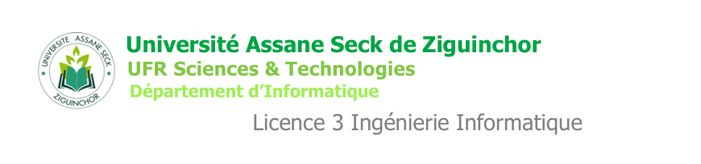

# Devoir — Développement d'Applications Orientées Services (SOA & Microservices)

**Université Assane Seck de Ziguinchor (UASZ)** — UFR Sciences & Technologies — Département d'Informatique  
**Filière :** Licence 3 Ingénierie Informatique (L2I) — Année universitaire 2025 – 2026  
**Enseignant responsable :** Dr Lamine FATY  

---

## Réalisé par le trinôme
- **Collé SYLL** (Matricule : `202300489`)
- **Ndeye Thiamba FAYE** (Matricule : `202300488`)
- **Mame Faty DIOP** (Matricule : `202101544`)

---

## 1. Présentation du projet

Ce dépôt contient le code source complet, la base de données MySQL (`patrimoinedb`), les configurations Docker et le rapport du devoir portant sur la mise en œuvre d'une architecture microservices pour la gestion du patrimoine touristique de Ziguinchor et de la Basse-Casamance.

L'application couvre les trois fiches de travaux pratiques du cours :
1. **TP 1 (Spring Data JPA & MySQL) :** Découpage du domaine en quatre microservices REST indépendants (`ms-patrimoine`, `ms-circuit`, `ms-evenement`, `ms-reservation`) adossés à la base de données relationnelle `patrimoinedb`.
2. **TP 2 (DTO, MapStruct & OpenFeign) :** Isolation des entités JPA par objets de transfert (DTO), mapping statique via MapStruct et communication synchrone déclarative entre `ms-circuit` et `ms-patrimoine` avec Spring Cloud OpenFeign.
3. **TP 3 (Conteneurisation Docker & Frontend Angular) :** Conteneurisation multi-étapes de chaque microservice (Maven + Eclipse Temurin Java 21 LTS), interface cliente sous Angular 17 servie par Nginx, et orchestration globale via `docker-compose.yml`.

---

## 2. Organisation du dépôt GitHub

```text
architecture-microservices-uasz/
├── 01_RAPPORT_ET_COMPTE_RENDU/
│   ├── COMPTE_RENDU_DEVOIR_SERVICES_SYLL_FAYE_DIOP.pdf   (Rapport officiel au format PDF)
│   ├── COMPTE_RENDU_DEVOIR_SERVICES_SYLL_FAYE_DIOP.docx  (Rapport officiel au format Word)
│   ├── COMPTE_RENDU_DEVOIR_SERVICES_SYLL_FAYE_DIOP.md    (Version Markdown)
│   └── RAPPORT_ILLUSTRATIONS/                            (Logo UASZ et captures réelles du site)
├── 02_MICROSERVICES_SOURCE/
│   ├── pom.xml                                           (POM parent Maven)
│   ├── ms-patrimoine/                                    (Microservice Patrimoine - Port 8081)
│   ├── ms-circuit/                                       (Microservice Circuit & OpenFeign - Port 8082)
│   ├── ms-evenement/                                     (Microservice Événement - Port 8083)
│   ├── ms-reservation/                                   (Microservice Réservation & Pass QR - Port 8084)
│   ├── frontend-angular/                                 (Client Web Angular 17 - Port 4200)
│   └── patrimoine-touristique-web/                       (Portail Spring MVC / Thymeleaf - Port 8080)
├── 03_BASE_DE_DONNEES/
│   ├── init_clean_utf8_data.sql                          (Script SQL d'initialisation UTF-8)
│   └── README_BASE_DE_DONNEES.txt
├── 04_SCRIPTS_EXECUTION/
│   ├── 1-DEMARRER-DOCKER.bat                             (Script de lancement automatique sous Windows)
│   └── 2-ARRETER-DOCKER.bat                              (Script d'arrêt des conteneurs)
├── docker-compose.yml                                    (Orchestration autonome avec conteneur MySQL)
├── docker-compose-xampp.yml                              (Orchestration alternative connectée à XAMPP local)
└── README.md
```

---

## 3. Récupération et exécution sur une autre machine (Binôme / Correcteur)

### Prérequis
- **Git** et **Docker Desktop** installés et démarrés.
- Aucune installation préalable de Java, Maven ou Node.js n'est requise sur la machine hôte : les `Dockerfile` compilent et embarquent automatiquement les dépendances.

### Étapes de lancement
1. Cloner le dépôt :
   ```bash
   git clone https://github.com/Collesyll0607/architecture-microservices-uasz.git
   cd architecture-microservices-uasz
   ```
2. Lancer l'ensemble des conteneurs (ou double-cliquer sur `04_SCRIPTS_EXECUTION/1-DEMARRER-DOCKER.bat`) :
   ```bash
   docker compose up --build -d
   ```
3. Accéder aux services depuis le navigateur :
   - **Application Frontend Angular :** `http://localhost:4200`
   - **Portail Web Spring Boot :** `http://localhost:8080`
   - **API REST `ms-patrimoine` :** `http://localhost:8081/api/patrimoines`
   - **API REST `ms-circuit` (OpenFeign) :** `http://localhost:8082/api/circuits`
   - **API REST `ms-evenement` :** `http://localhost:8083/api/evenements`
   - **API REST `ms-reservation` :** `http://localhost:8084/api/reservations`

### Comptes de démonstration (mot de passe : `passer123`)
- **Touriste :** `aissatou.fall@gmail.com` (ou bouton de connexion rapide *Touriste*)
- **Guide :** `guide@zig.sn` (ou bouton de connexion rapide *Guide*)
- **Conservateur :** `conservateur@zig.sn` (ou bouton de connexion rapide *Conservateur*)

---

## 4. Paramètres et variables d'environnement

| Variable | Description | Valeur par défaut dans `docker-compose.yml` |
| :--- | :--- | :--- |
| `SERVER_PORT` | Port HTTP interne du microservice | `8081`, `8082`, `8083`, `8084`, `8080` |
| `SPRING_DATASOURCE_URL` | URL JDBC de la base MySQL | `jdbc:mysql://patrimoine-db:3306/patrimoinedb` |
| `SPRING_DATASOURCE_USERNAME` | Utilisateur MySQL | `root` |
| `SPRING_DATASOURCE_PASSWORD` | Mot de passe MySQL | `""` (vide) |
| `MS_PATRIMOINE_URL` | Adresse cible du client OpenFeign dans `ms-circuit` | `http://ms-patrimoine:8081` |
| `MS_CIRCUIT_URL` | Adresse cible vers `ms-circuit` | `http://ms-circuit:8082` |
| `MS_EVENEMENT_URL` | Adresse cible vers `ms-evenement` | `http://ms-evenement:8083` |
